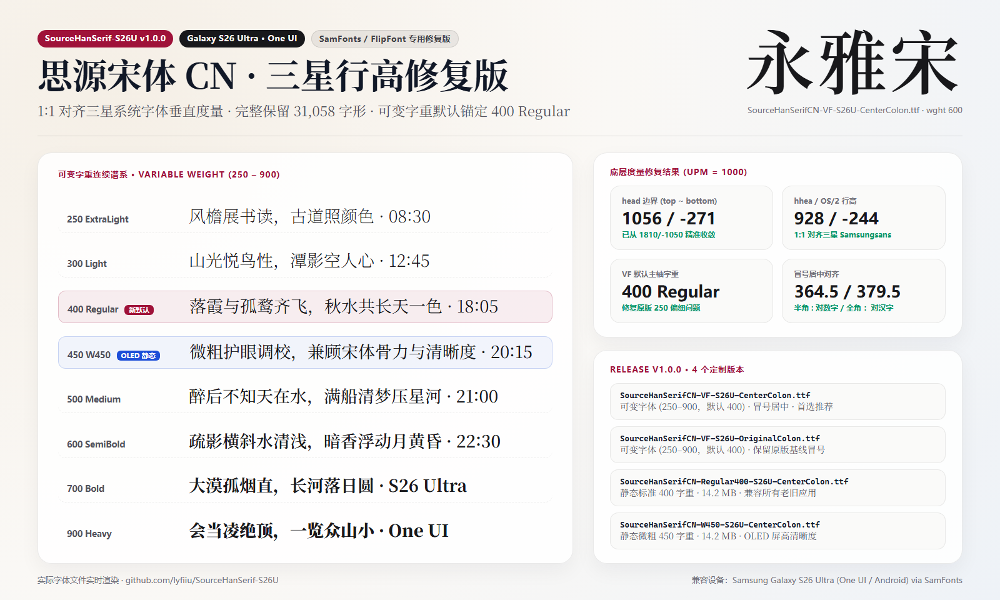
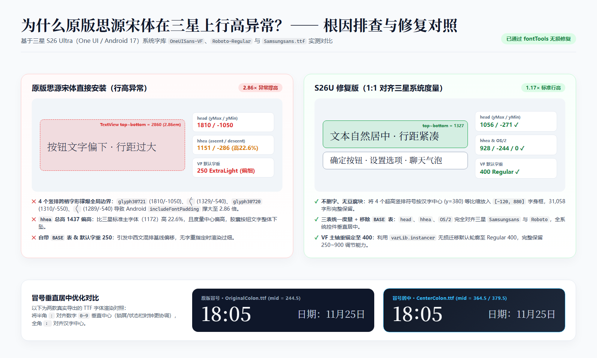
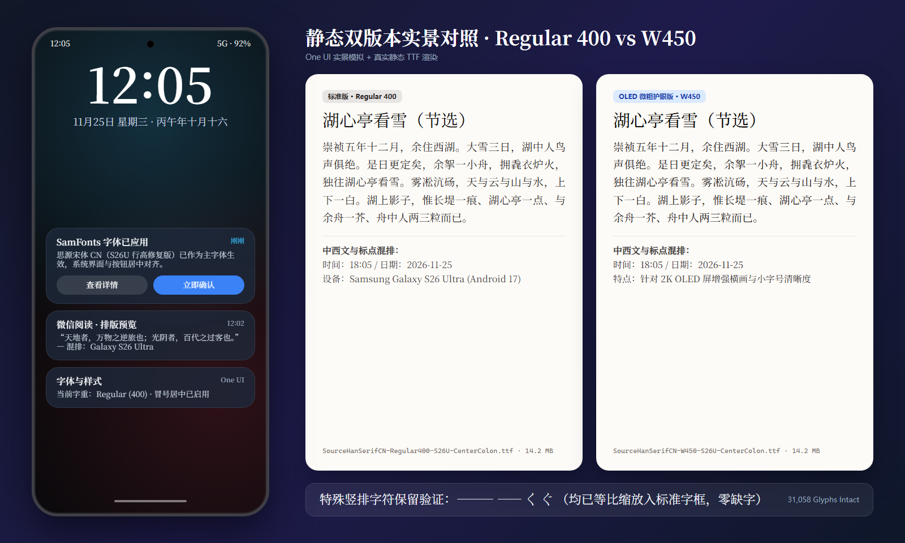

# SourceHanSerif-S26U（三星 S26 Ultra / One UI 思源宋体行高修复版）

专为三星 Galaxy S26 Ultra（One UI / Android）通过 **SamFonts（FlipFont 机制）** 安装而定制的思源宋体 CN（`SourceHanSerifCN`）TTF 字体包，彻底解决原版思源宋体作为系统主字体时行高异常偏高的问题。

---

## 效果展示

### 1. 字重谱系与整体风貌（可变字重 250–900）

### 2. 行高修复机制与冒号居中对比

### 3. One UI 手机实景模拟 & 静态双版本对照（Regular 400 vs W450）

---

## 为什么原版思源宋体在三星上行高异常？

通过读取系统 `/system/etc/fonts.xml` 及内置字体（`OneUISans-VF.ttf`、`Roboto-Regular.ttf`、`Samsungsans.ttf`）对比发现，SamFonts 替换系统第 0 号主字体时，原版思源宋体存在 3 个问题：

1. **4 个竖排跨格符号撑爆 `head` 表边界（`yMax = 1810, yMin = -1050`）**
   - `glyph30721`（`uni2E3B.aalt.vert`，竖排三倍破折号）：`yMax = 1810, yMin = -1050`（单字总高 `2860`，接近字号的 **2.86 倍**）
   - `uni3032`（`U+3032 〲`）：`yMax = 1329, yMin = -540`
   - `glyph30720`（`uni2E3A.aalt.vert`，竖排双倍破折号）：`yMax = 1310, yMin = -550`
   - `uni3031`（`U+3031 〱`）：`yMax = 1289, yMin = -540`
   - Android 原生 `TextView` 默认启用 `includeFontPadding`，`FontMetrics.top / bottom` 直接受 `head.yMax / yMin` 影响，导致单行/首末行高度异常拉高。
2. **`hhea` / `OS/2` 垂直度量高于系统主字体标准 22.6%**
   - 原版思源宋体 `hhea` 为 `1151 / -286`（总高 `1437`），而三星 `Samsungsans.ttf` / `Roboto-Regular.ttf` 为 `928 / -244`（总高 `1172`）。
3. **可变字体（VF）默认主轴字重偏细且带有 `BASE` 表偏移**
   - 原版 `SourceHanSerifCN-VF.ttf` 的 `fvar` 默认字重设在 `250 (ExtraLight)`，而三星系统字体默认为 `400 (Regular)`。

---

## 修复前后参数对比（`UPM = 1000`）

| 字体 | `head (yMax / yMin)` | `hhea (ascent / descent / lineGap)` | `OS/2 sTypo` | `fvar` 默认字重 |
| :--- | :---: | :---: | :---: | :---: |
| 三星官方 `Samsungsans.ttf` / `Roboto` | `1056 / -271` | `928 / -244 / 0` | `928 / -244 / 0` | `400` |
| 原版思源宋体 `SourceHanSerifCN-VF` | `1810 / -1050` | `1151 / -286 / 0` | `880 / -120 / 0` | `250` |
| **本仓库 S26U 修复版** | **`1056 / -271`** | **`928 / -244 / 0`** | **`928 / -244 / 0`** | **`400`** |

主要改动：
- 将上述 4 个超高竖排符号按汉字视觉中心等比缩放入标准字身框 `[-120, 880]`，其余极端边界收敛至 `[-271, 1056]`，**不删字、不缺字**。
- 将 `head`、`hhea`、`OS/2` 垂直度量 1:1 对齐三星系统主字体（`928 / -244`，`head` `1056 / -271`），清除 `USE_TYPO_METRICS` 冲突位并移除 `BASE` 表干扰。
- 使用 `fontTools.varLib.instancer` 将 VF 默认主轴从 `250` 迁移至 `400 (Regular)`，完整保留 `250 ~ 900` 全轴无级调节。

---

## Release 下载版本说明

请前往本仓库 **[Releases v1.0.0](../../releases/latest)** 下载对应 `.ttf` 文件并使用 **SamFonts** 安装：

1. **`SourceHanSerifCN-VF-S26U-CenterColon.ttf`**（推荐首选，约 32.8 MB）
   - 可变字体（`wght` `250~900`，默认 `400`），半角冒号 `:` 与数字 `0-9` 垂直居中（锁屏/状态栏时间更美观），全角冒号 `：` 与汉字居中。
2. **`SourceHanSerifCN-VF-S26U-OriginalColon.ttf`**（约 32.8 MB）
   - 同上可变字体版本，保留原版基线冒号位置。
3. **`SourceHanSerifCN-Regular400-S26U-CenterColon.ttf`**（约 14.2 MB）
   - 静态字重 `400 (Regular)`，冒号居中，兼容不支持可变字体的老旧 App。
4. **`SourceHanSerifCN-W450-S26U-CenterColon.ttf`**（约 14.2 MB）
   - 静态字重 `450`（微粗护眼版），冒号居中，针对高分 OLED 屏增强宋体细横画可读性。

---

## 构建脚本

仓库中的 [`build_s26u_fonts.py`](./build_s26u_fonts.py) 基于 Python `fonttools` 实现，可自行修改字重（如 `420`、`480`）或度量参数重新生成。
